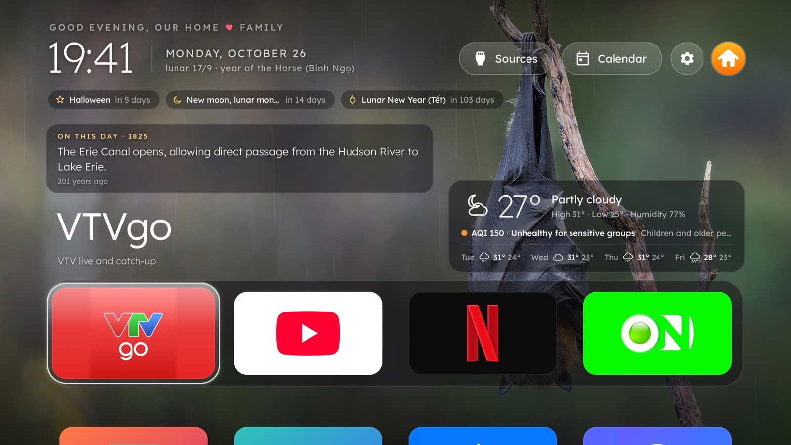

# Nhà Mình: an Apple TV–style home screen for Samsung Tizen TVs

*Nhà Mình* ("our home" in Vietnamese) is an app that takes the place of the home screen on a Samsung Tizen TV. It has an
Apple TV–style dock and grid of your apps, photo wallpapers that change through the day, weather and air quality, a lunar
calendar, news, an English word a day, a YouTube row, and remote-friendly games. Leave any app and you come back here.
It installs through the TV's Developer Mode, with no root. The family name, city and family photos are set from a phone.

The UI follows the TV's menu language: Vietnamese, or English for any other language. Change it in
*Settings → Ngôn ngữ / Language*. [Tiếng Việt →](README.md)



## Features

- **Apps**: the apps installed on the TV, found automatically. A dock of four (VTV GO, YouTube, Netflix and VieON by
  default; keys 1–4 open them), a grid of the other apps and four games. Hold OK on a tile to move it.
- **YouTube row**: rest on the YouTube tile and the newest videos of a set of channels slide up above the dock. ▲ to pick,
  OK plays the video straight away (even when YouTube is already open), ▼ folds the row away. Public RSS, no API key.
- **Word of the Day**: a new English word every day, chosen by topic, with IPA, definitions, example sentences and
  synonyms (and Vietnamese meanings and translations when the UI is Vietnamese). OK reads it aloud (again: slowly), ▲ ▼
  pick an example sentence to hear, ◀ ▶ go back through the words learned or learn one more. Three levels: Basic,
  Intermediate, Advanced. There is no bundled word list: words come from a public source (Datamuse) by topic, and every
  word learned becomes a future topic, so it never runs out. The day's word also shows in the *Today* block and on the
  screensaver.
- **Today block**, taking turns: a saying (ZenQuotes in the original, plus English versions of a curated set of quotes and
  Vietnamese proverbs), *On this day* from English Wikipedia, the latest news (VnExpress International, BBC World), the
  English word, and the gold price and USD rate in Vietnam (PNJ, Vietcombank).
- **Weather and AQI** (Open-Meteo): temperature, a 4-day forecast, air quality with advice, "rain likely in ~N min".
- **Coming up**: holidays, full and new moons of the lunar calendar, family birthdays, a countdown to Lunar New Year.
- **Calendar**: a month grid with lunar dates; OK on a day shows its stem and branch, auspicious or not, the solar term,
  the lucky hours and *On this day*.
- **Wallpaper**: Bing photos from 13 countries, a store that grows to 120 photos, a new one every hour (adjustable), kept
  on schedule across TV restarts. A gallery to use a photo for now or keep it. Also family photos, a mix, a sky that
  follows the hour, or plain black.
- **Screensaver** after 3 idle minutes: crossfading photos (family photos mixed in), clock, weather, a saying, the word.
- **Setup from a phone or laptop**: scan the QR code on the TV, enter the PIN, then set the family name, the city,
  birthdays, family photos and an avatar from the browser. The page is in English or Vietnamese.
- **Ad-free YouTube (optional)**: install [TizenTube](https://github.com/reisxd/TizenTube) (third party) and it shows as
  its own tile with artwork and a description. `TizenTubeOld.wgt` is for 2017–2020 TVs, `TizenTubeCobalt.wgt` for 2021
  and later (in Apps2Samsung's settings turn on *Force Samsung Certificate* and *Partner Signing* for Cobalt). TizenBrew,
  and TizenTube on older TVs at its best, need Developer Mode's *Host PC IP* set to `127.0.0.1`; the home screen keeps
  working with that, so switch to your computer's IP only while installing or updating apps.
- **Back home after every app**: a background service watches the app you opened (from here or from Smart Hub) and
  brings the home screen back, usually within a second. Waking the TV from standby lands here too.
- **Frees memory**: apps left running in the background for more than 5 minutes are closed.
- **Light on the TV**: everything is stored on the TV, so opening the app never waits for the network; each source is
  fetched only when it is due. Runs on the Chromium 69 of Tizen 5.5.

## Install

The step-by-step guide (Windows, macOS, Linux, Android, with troubleshooting) is in Vietnamese:
[docs/huong-dan-cai-dat.md](docs/huong-dan-cai-dat.md). In short:

1. **Turn on Developer Mode on the TV**: open *Apps*, press `1 2 3 4 5` on the remote (no number keys: press **123** for
   the on-screen keypad), switch *Developer mode* on, set *Host PC IP* to the IP of the computer or phone you will
   install from, then unplug the TV for 10–15 seconds.
2. **Get [Apps2Samsung](https://github.com/Apps2Samsung/Apps2Samsung/releases)** for your device (Windows, macOS, Linux
   or Android).
3. **Install**: download `NhaMinh-<version>.wgt` from the
   [latest release](https://github.com/meocong/prj-tv-samsung/releases/latest); in Apps2Samsung, *Scan for TVs* → pick
   the TV → *Custom WGT / TPK* → *Browse…* → *Install*. When Apps2Samsung's community catalog lists *Nhà Mình*, you can
   pick it there instead. TVs from 2023 on ask for a Samsung account once (for the signing certificate).
4. **Personalise**: on the TV, *Settings → Set up from a phone or computer*, and scan the QR code with a phone on the same
   Wi-Fi.

Then see [docs/cai-dat-tv.md](docs/cai-dat-tv.md) (Vietnamese; the menu names are given in English too) for the TV
settings that make the TV open on this screen, with fewer ads and less tracking.

**Compatibility**: Samsung Tizen TVs from 2017 on. Tested in depth on a 2020 model (UA50TU8500, Tizen 5.5).

## Settings

On the TV, *Settings* (the gear button or the blue key): screensaver, wallpaper and how often it changes, tiles per row,
which apps to show, the weather location, gold price and exchange rate, closing background apps, Word of the Day (on or
off, level), and *Ngôn ngữ / Language* (the TV's language, Tiếng Việt, English). The *About* page tells you when a new
version is out.

Building from source: the defaults live in [app/config.js](app/config.js) (dock, hidden apps, YouTube channels, HDMI
names, the defaults of *Settings*). A household's own configuration can go in `local/` (ignored by Git), which
`tools/tvdev.py deploy` and `tools/preview.py` lay over `app/`; see `local.example/`. What is set from a phone wins.

## Development

Needs Python 3.9+ and Node.js; works on Windows (`py` instead of `python3`), macOS and Linux.

```bash
python3 tools/tvdev.py setup                  # once: Tizen Studio CLI, signing certificate, tools/.venv
python3 tools/tvdev.py deploy --tv <TV IP>    # check, package (with local/), install on the TV, open the app
python3 tools/tvdev.py check                  # rejects JS/CSS that the TV's Chromium 69 does not understand
python3 tools/tvdev.py release                # package the public build into dist/
python3 tools/tvdev.py install --tv <TV IP> app.wgt   # re-sign another .wgt (TizenTube…) with this certificate and install it
python3 tools/preview.py 8765 --public        # preview in Chrome at http://localhost:8765
node --test tests/*.test.js                   # tests: lunar calendar, holidays, sayings, prices, apps, service,
                                              # English strings, word choice…
```

- **Debugging on the TV**: `python3 tools/tvdev.py debug --tv <TV IP>`, then
  `node tools/inspect.js --port 9333 --eval "NhaMinhDebug.wall()"` (run JS, send keys).
- **Text on screen**: strings are written in Vietnamese inside `T('…')` (numbers and names as `T('Còn {0} ngày', n)`);
  the English goes in [app/js/i18n-en.js](app/js/i18n-en.js). Fixed text in `index.html` carries a `data-t` attribute.
  `tests/i18n.test.js` lists any string without an English version.
- **Releases**: push a tag like `v1.3.0`; [release.yml](.github/workflows/release.yml) runs the tests, packages the app
  and attaches `NhaMinh-<version>.wgt` to the GitHub Release. The version comes from `app/config.xml`.

## How it works

- **Apps** come from the TV itself (`tizen.application.getAppsInfo`), filtered to what the *Apps* screen shows.
- **Background service** ([app/service/watch.js](app/service/watch.js)), since Samsung lets no sideloaded app take the
  Home button: it polls the TV's own REST API (`127.0.0.1:8001`) and reopens the home screen when the app it watches
  closes or goes to the background; it brings the home screen up once when the TV wakes; it closes apps left in the
  background; and it serves the phone setup page on port 8701 (writes need the PIN shown on the TV).
- **Two languages** ([app/js/i18n.js](app/js/i18n.js)): the language is decided once when the app opens (`auto` follows
  the TV's `navigator.language`); changing it reloads the app. Each content source has a version per language and its
  own store.
- **Word of the Day** ([app/js/words.js](app/js/words.js)): the next topic in a queue → Datamuse returns related words
  with how common they are → keep single words of the chosen level that were not learned yet → the word learned joins the
  queue as a topic. Content from Google Translate (definitions, examples, synonyms, Vietnamese meanings), IPA from the
  Free Dictionary API (Wiktionary), Datamuse as a fallback; sentences unfit for a family screen are left out. Speech is
  Google Translate's voice in an `<audio>` element. The Lexend font has no IPA symbols, so phonetics use a small subset
  of Noto Sans, loaded only when needed.

### What the TV stores

| Store | Keeps | Refreshed |
|---|---|---|
| Wallpaper images (IndexedDB) | 30 photos ≈ 12 MB, least recently used dropped | the next photo is fetched ahead |
| Family photos, avatar (IndexedDB) | what the phone sent | when new photos arrive |
| Bing photo list | the 120 newest | once a day |
| Sayings | 600 quotes (50 more each day) and proverbs | daily; proverbs weekly |
| YouTube row | the 12 newest videos | hourly |
| News | 40 stories | 20 minutes |
| Gold price, exchange rate | the latest | 30 minutes |
| On this day (IndexedDB) | for good, at most 366 day pages | once per day of the year; the next 7 days ahead |
| Weather | one forecast per place picked | when older than 20 minutes |
| Word of the Day (IndexedDB) | every word learned, for good (≈ 2 KB each), the history, the topic queue | one word a day; one more when you press ▶ on the newest |

## Limitations

- The **Home** button always opens Samsung's own Home bar; no app can take it over.
- Samsung does not start sideloaded apps when the TV boots from cold (unplugged, power cut): open the tile once, or run
  [`tools/autostart.py`](tools/autostart.py) on an always-on device on the same network. Waking from standby is fine.
- No root in Developer Mode, so Samsung's system services cannot be switched off.
- "Continue watching" in YouTube or Netflix lives inside those apps; Samsung lets no other app read it.

## License

[MIT](LICENSE) © 2026 Nguyễn Trọng Hoàng Việt. Third-party code keeps its own license (see [NOTICE](NOTICE)).

## Credits

Inspired by [cleanyourtv](https://github.com/Gathin23/cleanyourtv) (Android TV); UI ported from
[webos-vibehack](https://github.com/OmkarK97/webos-vibehack). Installed with
[Apps2Samsung](https://github.com/Apps2Samsung/Apps2Samsung). Games, fonts, the QR library and other third-party code:
see [NOTICE](NOTICE).

Data: Bing Image of the Day, [Open-Meteo](https://open-meteo.com) (CC BY 4.0), Wikipedia and Wikiquote (CC BY-SA),
[ZenQuotes](https://zenquotes.io), PNJ (gold), Vietcombank (exchange rates), the RSS feeds of VnExpress, VnExpress
International, Thanh Niên, Dân Trí, the BBC and the YouTube channels. Word of the Day: [Datamuse](https://www.datamuse.com/api/),
[Free Dictionary API](https://dictionaryapi.dev) (Wiktionary data, CC BY-SA), Google Translate. Lunar calendar algorithm
after Hồ Ngọc Đức. App logos in `app/icons/` belong to their owners.
