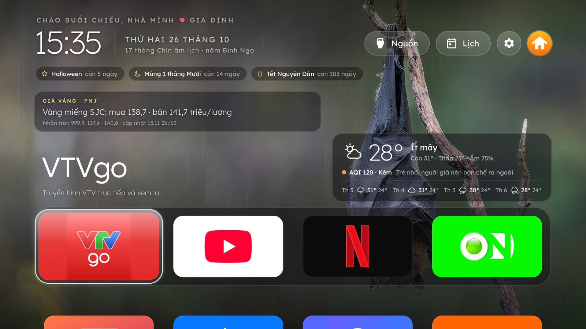
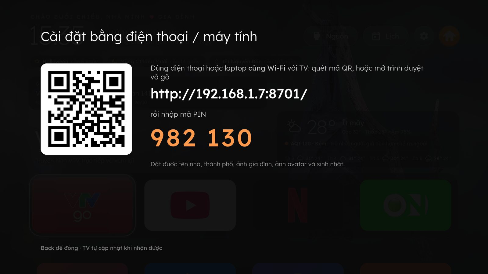
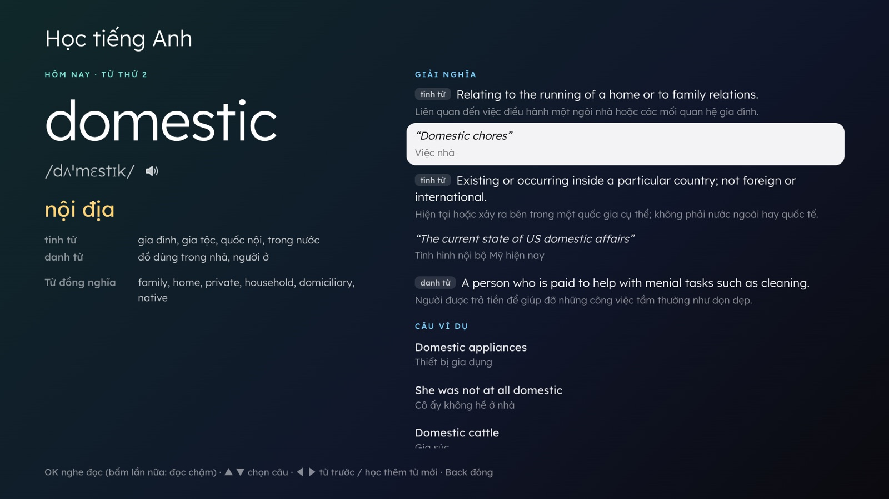
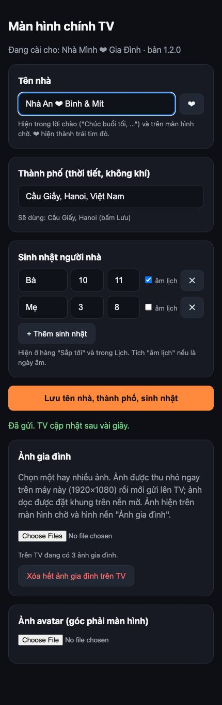

# Nhà Mình: màn hình chính kiểu Apple TV cho TV Samsung (Tizen)

Một app thay chỗ màn hình Home cho TV Samsung chạy Tizen. Giao diện kiểu Apple TV, hình nền đẹp đổi theo giờ, thời
tiết và chất lượng không khí, lịch vạn niên, tin tức, giá vàng và tỷ giá, hàng video YouTube, mỗi ngày một từ tiếng Anh
(nghe đọc, nghĩa, câu ví dụ), game chơi bằng remote. Thoát app nào cũng quay về đây. Giao diện tiếng Việt hoặc tiếng Anh.
Cài bằng Developer Mode của TV, không cần root; tên nhà, thành phố, ảnh gia đình đặt bằng điện thoại.

*An Apple TV–style home screen for Samsung Tizen TVs: rotating photo wallpapers, weather and air quality, a lunar
calendar, news, an English word a day, a YouTube row, remote-friendly games, phone-based setup, and a background service
that brings you back home when you leave an app. Vietnamese or English UI, following the TV's language. Installs with
[Apps2Samsung](https://github.com/Apps2Samsung/Apps2Samsung) on Windows, macOS, Linux or Android.*
**[Read this in English →](README.en.md)**


| | |
|---|---|
|  **Hàng YouTube**: video mới của các kênh chọn sẵn, OK là phát |  **Ứng dụng và game** |
|  **Lịch vạn niên** âm dương |  **Xem ngày**: trực, sao, giờ hoàng đạo, hướng xuất hành… |
|  **Hôm nay**: giá vàng, tỷ giá, câu nói hay, ngày này năm xưa, tin mới |  **Tin mới** từ VnExpress, Thanh Niên, Dân Trí |
|  **Cài đặt bằng điện thoại / máy tính**: quét QR, nhập PIN |  **Thư viện hình nền** |
|  **Cài đặt** nhiều tầng |  **Màn hình chờ** |
|  **Học tiếng Anh**: mỗi ngày một từ, OK để nghe đọc |  **Giao diện tiếng Anh** |

*Ảnh chụp từ bản xem thử với cấu hình mẫu. Ảnh nền là ảnh Bing trong ngày.*

## Tính năng

- **Ứng dụng**: tự nhận các app đã cài trên TV. Dock 4 app (mặc định VTV GO, YouTube, Netflix, VieON; phím 1–4 mở
  thẳng), lưới các app còn lại và 4 game. Giữ OK trên một ô để sắp xếp lại.
- **Hàng YouTube**: dừng ở ô YouTube thì video mới của các kênh chọn sẵn hiện trên dock. ▲ để chọn, OK để phát thẳng video
  (cả khi YouTube đang mở), ▼ để gập lại. Dùng RSS công khai, không cần API key.
- **Khối Hôm nay** xoay vòng:
  - *giá vàng* (vàng miếng SJC, nhẫn trơn 999.9, nguồn PNJ) và *tỷ giá USD* (Vietcombank);
  - *ngày này năm xưa* (Wikipedia);
  - *tin mới*;
  - *câu nói hay*: mỗi lượt một câu, gồm 50 danh ngôn mới mỗi ngày (ZenQuotes, dịch sang tiếng Việt), ~130 câu chọn sẵn
    và tục ngữ (Wikiquote).
- **Học tiếng Anh**: mỗi ngày một từ mới theo chủ đề, có phiên âm IPA, nghĩa tiếng Việt theo từ loại, giải nghĩa tiếng
  Anh có dịch, câu ví dụ có dịch, từ đồng nghĩa. OK để nghe đọc (bấm lần nữa: đọc chậm), ▲ ▼ chọn câu ví dụ để nghe,
  ◀ ▶ xem lại các từ đã học hoặc học thêm từ mới. Ba trình độ (Cơ bản, Trung cấp, Nâng cao). Từ của ngày còn hiện trong
  khối Hôm nay và trên màn hình chờ. Không có danh sách từ đóng gói sẵn: từ lấy từ nguồn công khai (Datamuse) theo
  chủ đề, chủ đề mới sinh ra từ chính các từ đã học, nên học mãi không hết.
- **Hai thứ tiếng**: giao diện theo ngôn ngữ menu của TV (tiếng Việt, còn lại là tiếng Anh), đổi được ở *Cài đặt →
  Ngôn ngữ / Language*. Giao diện tiếng Anh dùng nội dung tiếng Anh: tin VnExpress International và BBC, "On this day"
  của Wikipedia tiếng Anh, danh ngôn nguyên bản và bản tiếng Anh của tục ngữ, ca dao; tên ngày lễ, tiết khí, ngày âm
  bằng tiếng Anh. Trang cài đặt trên điện thoại cũng có hai thứ tiếng.
- **Thời tiết và AQI** (Open-Meteo): nhiệt độ, dự báo 4 ngày, chất lượng không khí kèm lời khuyên, "có thể mưa sau ~N phút".
- **Sắp tới**: Rằm, Mùng 1, ngày lễ dương và âm lịch, sinh nhật người nhà, đếm ngược Tết.
- **Lịch vạn niên**: lưới tháng âm dương. OK trên một ngày mở *Xem ngày*: can chi, Trực, 28 sao, nạp âm, giờ hoàng đạo,
  giờ Lý Thuần Phong, hướng xuất hành, tuổi xung, Bành Tổ, ngày Tam nương/Nguyệt kỵ/Dương công, ngày này năm xưa.
  Kết quả khớp với lichvannien.net (có test).
- **Hình nền**: ảnh Bing của 13 nước, kho tự lớn dần tới 120 ảnh, đổi mỗi giờ (chỉnh được), giữ đúng nhịp đổi qua các
  lần tắt TV. *Thư viện hình nền* để chọn một ảnh dùng tạm hoặc giữ cố định. Có thêm chế độ ảnh gia đình, kết hợp, bầu
  trời theo giờ, nền đen.
- **Màn hình chờ** sau 3 phút không bấm gì: ảnh chuyển mờ dần xen ảnh gia đình, đồng hồ, âm lịch, thời tiết, câu nói.
- **Cài đặt bằng điện thoại hoặc laptop**: quét mã QR trên TV, nhập mã PIN, rồi đặt tên nhà, thành phố, sinh nhật, tải
  ảnh gia đình và ảnh avatar ngay từ trình duyệt.
- **Thoát app là về đây**: dịch vụ nền canh app đang mở (kể cả mở từ Smart Hub) và đưa về màn hình chính, thường dưới
  1 giây. Bật TV từ chế độ ngủ cũng vào thẳng màn hình chính.
- **Giải phóng RAM**: app chạy ẩn quá 5 phút (Netflix thoát ra vẫn chạy ngầm) được đóng lại.
- **Nguồn vào** (HDMI, truyền hình, đặt tên riêng cho cổng), **Cài đặt** nhiều tầng như Apple TV, lối tắt vào cài đặt của
  TV, báo khi có bản mới.
- **Nhẹ trên TV**: mọi thứ lưu sẵn trên TV, mở app không phải chờ mạng, chỉ cập nhật khi tới hạn (xem
  [Kho dữ liệu](#kho-dữ-liệu-trên-tv)). Chạy trên Chromium 69 của Tizen 5.5.

## Cài đặt

**Hướng dẫn từng bước cho Windows, macOS, Linux và Android, kèm cách xử lý lỗi:
[docs/huong-dan-cai-dat.md](docs/huong-dan-cai-dat.md).** Tóm tắt:

1. **Bật Developer Mode trên TV**: *Ứng dụng* → bấm `1 2 3 4 5` (remote không có phím số thì bấm nút **123**) → bật
   *Developer mode*, *Host PC IP* = IP của máy dùng để cài → rút điện TV 10–15 giây rồi cắm lại.
2. **Tải [Apps2Samsung](https://github.com/Apps2Samsung/Apps2Samsung/releases)** cho máy của bạn (Windows, macOS, Linux
   hoặc Android).
3. **Tải `NhaMinh-<phiên bản>.wgt`** ở [bản phát hành mới nhất](https://github.com/meocong/prj-tv-samsung/releases/latest).
4. **Cài**: Apps2Samsung → *Quét để tìm TV* → chọn TV → *Custom WGT / TPK* → *Duyệt…* chọn file `.wgt` → *Cài ngay*.
   TV đời 2023 trở đi đăng nhập tài khoản Samsung một lần.
5. **Cá nhân hóa**: trên TV, *Cài đặt → Cài đặt bằng điện thoại / máy tính*, quét mã QR bằng điện thoại.

Sau đó làm theo [docs/cai-dat-tv.md](docs/cai-dat-tv.md) để bật TV là vào màn hình chính, bớt quảng cáo và theo dõi.

**Tương thích**: TV Samsung Tizen đời 2017 trở đi. Đã kiểm tra kỹ trên đời 2020 (UA50TU8500, Tizen 5.5); TV đời 2023 trở
đi cần chứng chỉ Samsung (Apps2Samsung tự tạo).

## Cá nhân hóa

**Bằng điện thoại hoặc laptop** (cách cho mọi người): trên TV, *Cài đặt → Cài đặt bằng điện thoại / máy tính* hiện mã QR,
địa chỉ `http://<IP TV>:8701/` và mã PIN. Mở trang đó trên một thiết bị cùng Wi-Fi để đặt:
- tên nhà (❤ hiện thành trái tim) và thành phố cho thời tiết;
- sinh nhật người nhà, dương hoặc âm lịch;
- ảnh gia đình: thu nhỏ ngay trên máy, ảnh dọc được đặt khung trên nền mờ;
- ảnh avatar.

Mọi thứ lưu trên TV.



Các mục khác chỉnh ngay trên TV trong **Cài đặt** (nút bánh răng hoặc phím xanh dương): màn hình chờ, hình nền, số ô mỗi
hàng, ẩn/hiện app, khu vực thời tiết, giá vàng và tỷ giá, đóng app chạy ngầm, Học tiếng Anh (bật/tắt, trình độ) và
*Ngôn ngữ / Language* (theo TV, tiếng Việt, English).

**Khi tự build từ mã nguồn**: giá trị mặc định nằm trong [app/config.js](app/config.js) (dock, app ẩn, kênh YouTube, tên
cổng HDMI, mặc định của Cài đặt). Cấu hình riêng của một nhà có thể để trong thư mục `local/` (không lên Git, đã có trong
`.gitignore`); `tools/tvdev.py deploy` và `tools/preview.py` ghép `local/` đè lên `app/`:

| File trong `local/` | Dùng để |
|---|---|
| `config.local.js` | Ghi đè `app/config.js`: `familyName`, `location`/`locations`, `familyPhotos`, `birthdays`… (mẫu: `local.example/`) |
| `app-name.txt` | Tên app trên Smart Hub (dòng đầu). Đổi tên thì phải gỡ app rồi cài lại TV mới nhận. |
| `img/avatar.jpg` | Ảnh avatar góc phải. |
| `img/family/*.jpg` | Ảnh gia đình 1920×1080 (tạo bằng `tools/photos.py`). |

Cài đặt đặt bằng điện thoại được ưu tiên hơn `local/`.

## Phát triển

Cần Python 3.9+ và Node.js; chạy được trên Windows (dùng `py` thay `python3`), macOS và Linux.

```bash
python3 tools/tvdev.py setup                  # một lần: Tizen Studio CLI, chứng chỉ ký app, tools/.venv
python3 tools/tvdev.py deploy --tv <IP TV>    # kiểm tra, đóng gói (ghép local/), cài lên TV, mở app
python3 tools/tvdev.py check                  # chặn cú pháp JS/CSS mà Chromium 69 của TV không hiểu
python3 tools/tvdev.py release                # đóng gói bản công khai vào dist/
python3 tools/preview.py                      # xem thử trên Chrome: http://localhost:8765 (ghép local/)
python3 tools/preview.py 8765 --public        # đúng như người khác thấy khi clone repo
node --test tests/*.test.js                   # test: lịch vạn niên, ngày lễ, câu nói, giá vàng, danh sách app, dịch vụ nền,
                                              # bản dịch tiếng Anh, chọn từ tiếng Anh…
```

- **Debug trên TV**: `python3 tools/tvdev.py debug --tv <IP TV>`, rồi
  `node tools/inspect.js --port 9333 --eval "NhaMinhDebug.wall()"` (chạy JS, gửi phím, chụp màn hình). `performance` có
  các mốc `scripts`, `home`, `ready` để đo thời gian mở app.
- **Dịch vụ nền**: `http://<IP TV>:8701/status` cho biết dịch vụ chạy từ lúc nào, đang canh app nào và nhật ký gần đây.
- **Trạng thái một app**: `curl http://<IP TV>:8001/api/v2/applications/<id>` (YouTube dùng mã store `111299001912`).
- **Điều khiển TV từ máy**: `tools/.venv/bin/python tools/tv.py key KEY_HOME`.
- **Danh mục app và icon** ([app/js/apps.js](app/js/apps.js), [app/icons/](app/icons/)): `tools/sync_apps.py` đọc app
  trên một TV và lấy icon đẹp; app không có trong danh mục vẫn hiện, với tên và icon của chính TV.
- **Thêm chữ trên màn hình**: viết câu tiếng Việt trong `T('…')` (số, tên: `T('Còn {0} ngày', n)`), thêm bản tiếng Anh vào
  [app/js/i18n-en.js](app/js/i18n-en.js). Chữ cố định trong `index.html` thì gắn thuộc tính `data-t`.
  `tests/i18n.test.js` báo câu nào chưa có bản tiếng Anh.
- **Phát hành**: đẩy một tag dạng `v1.3.0`; workflow [release.yml](.github/workflows/release.yml) chạy test, đóng gói và
  gắn `NhaMinh-<phiên bản>.wgt` vào GitHub Release. Phiên bản lấy từ `app/config.xml`.

## Cách hoạt động

- **Danh sách app**: lấy từ chính TV (`tizen.application.getAppsInfo`), lọc ra các app người dùng thấy trong mục Ứng
  dụng. App có trong danh mục (`apps.js`) dùng icon và mô tả đẹp, app khác dùng tên và icon của TV.
- **Dịch vụ nền** ([app/service/watch.js](app/service/watch.js)), vì Samsung không cho app tự cài làm nút Home:
  - hỏi REST API của chính TV (`127.0.0.1:8001`) mỗi 0,3 giây: app đang canh tắt, hoặc khuất quá 1,2 giây, thì mở lại
    màn hình chính;
  - khi không có app nào được mở từ đây, vài giây một lần dò xem có app nào đang hiện để canh luôn;
  - TV từ chế độ ngủ bật lại thì đưa màn hình chính lên một lần, rồi để yên cho người dùng;
  - đóng app chạy ẩn quá lâu để giải phóng RAM.
- **Trang cài đặt bằng điện thoại**: dịch vụ nền chạy một máy chủ web nhỏ ở cổng 8701, phục vụ
  [app/service/setup.html](app/service/setup.html). Những gì điện thoại gửi lên (bắt buộc kèm mã PIN) chờ trong dịch vụ,
  tới khi màn hình chính lấy về và lưu ([app/js/profile.js](app/js/profile.js)).
- **Mở thẳng video YouTube**: app-control `PAYLOAD` dạng `v=<mã video>&t=0`, giống điện thoại cast lên TV.
- **Hai thứ tiếng** ([app/js/i18n.js](app/js/i18n.js)): chữ trong code viết bằng tiếng Việt, bọc trong `T()`; giao diện
  tiếng Anh tra bảng [i18n-en.js](app/js/i18n-en.js). Ngôn ngữ chọn một lần lúc mở app (`auto` theo `navigator.language`
  của TV), đổi ngôn ngữ thì app tải lại. Mỗi nguồn nội dung có bản theo ngôn ngữ và kho riêng.
- **Học tiếng Anh** ([app/js/words.js](app/js/words.js)):
  - chọn từ: chủ đề kế tiếp trong hàng chờ → Datamuse trả các từ liên quan kèm độ phổ biến → giữ từ đơn, đúng trình độ,
    chưa học, không phải dạng biến đổi của từ đã học → từ học xong thành chủ đề về sau;
  - nội dung: Google Dịch (nghĩa tiếng Việt, định nghĩa, câu ví dụ, từ đồng nghĩa, dịch các câu), phiên âm IPA của
    dictionaryapi.dev (Wiktionary), Datamuse dự phòng; câu không hợp màn hình gia đình bị lọc;
  - phát âm: giọng đọc của Google Dịch phát bằng `<audio>`; phông Lexend thiếu ký hiệu IPA nên phiên âm dùng một phần nhỏ
    của Noto Sans (`app/fonts/NotoSans-IPA.ttf`, chỉ tải khi cần).
- **Mượt trên TV yếu**:
  - hình nền vẽ sẵn vào canvas, chỉ 1–2 lớp toàn màn hình;
  - các khối mờ dần có lớp riêng;
  - ảnh được giải mã xong mới chuyển;
  - việc phụ dời sang lúc rảnh;
  - thư viện webapis của Samsung được tải sau khi màn hình chính đã hiện.

### Kho dữ liệu trên TV

Mở app là hiện ngay từ kho, chỉ tải mạng khi đã tới hạn. Kho nào cũng có giới hạn.

| Kho | Giữ | Làm mới |
|---|---|---|
| Ảnh nền (IndexedDB) | 30 ảnh ≈ 12 MB, xóa ảnh lâu không dùng nhất | ảnh kế tiếp tải sẵn |
| Ảnh gia đình, avatar (IndexedDB) | ảnh gửi từ điện thoại | khi gửi ảnh mới |
| Danh sách ảnh Bing | 120 ảnh gần nhất | mỗi ngày một lần |
| Câu nói hay | 600 danh ngôn (cộng dồn 50 câu mỗi ngày) và tục ngữ | mỗi ngày; tục ngữ mỗi tuần |
| Hàng YouTube | 12 video mới nhất | mỗi giờ |
| Tin mới | 40 tin | 20 phút |
| Giá vàng, tỷ giá | bản gần nhất | 30 phút |
| Ngày này năm xưa (IndexedDB) | mãi mãi, tối đa 366 trang ngày ≈ 1,5 MB | mỗi ngày chỉ tải một lần; tải sẵn 7 ngày tới |
| Thời tiết | mỗi nơi đã chọn một bản | khi bản đang có cũ hơn 20 phút |
| Học tiếng Anh (IndexedDB) | mọi từ đã học, mãi mãi (≈ 2 KB một từ), lịch sử từng ngày, hàng chờ chủ đề | mỗi ngày một từ; thêm từ khi bấm ▶ ở từ mới nhất |

Tin mới, ngày này năm xưa và câu nói hay có kho riêng cho từng ngôn ngữ.

## Hạn chế

- Nút **Home** trên remote luôn mở thanh Home của Samsung; không app nào thay được nút này.
- Samsung không cho app cài bằng chứng chỉ thường tự chạy khi TV khởi động hẳn (rút điện, mất điện): khi đó mở ô màn hình
  chính một lần, hoặc chạy [`tools/autostart.py`](tools/autostart.py) trên một thiết bị luôn bật cùng mạng. TV ngủ rồi
  bật lại thì màn hình chính tự lên.
- Không tắt được dịch vụ hệ thống của Samsung: Developer Mode không có root hay shell.
- Gợi ý, "xem tiếp" của YouTube, Netflix nằm trong từng app; Samsung không cho app khác đọc.

Chi tiết và cách gỡ bỏ: [docs/cai-dat-tv.md](docs/cai-dat-tv.md).

## Cấu trúc

```
app/            app web Tizen: config.xml, index.html, css/, js/, service/ (dịch vụ nền, trang cài đặt), games/, icons/, img/
local.example/  mẫu cấu hình riêng khi tự build (chép thành local/, không lên Git)
tools/          tvdev.py (setup, check, deploy, debug, release), preview.py, photos.py, sync_apps.py, tv.py, inspect.js,
                autostart.py (cho thiết bị luôn bật: TV bật là mở màn hình chính)
docs/           huong-dan-cai-dat.md, cai-dat-tv.md, screenshots/
tests/          test Node
.github/        workflow phát hành
```

## Giấy phép

[MIT](LICENSE) © 2026 Nguyễn Trọng Hoàng Việt. Mã của bên thứ ba giữ giấy phép riêng (xem [NOTICE](NOTICE)).

## Ghi công

Lấy cảm hứng từ [cleanyourtv](https://github.com/Gathin23/cleanyourtv) (Android TV). Giao diện port từ
[webos-vibehack](https://github.com/OmkarK97/webos-vibehack). Cài đặt nhờ [Apps2Samsung](https://github.com/Apps2Samsung/Apps2Samsung).
Game, font, thư viện QR và mã của bên thứ ba cùng giấy phép của chúng: xem [NOTICE](NOTICE).

Dữ liệu: Bing Image of the Day, [Open-Meteo](https://open-meteo.com) (CC BY 4.0), Wikipedia tiếng Việt, tiếng Anh và
Wikiquote tiếng Việt (CC BY-SA), [ZenQuotes](https://zenquotes.io), PNJ (giá vàng), Vietcombank (tỷ giá), RSS của
VnExpress, VnExpress International, Thanh Niên, Dân Trí, BBC và các kênh YouTube. Học tiếng Anh: [Datamuse](https://www.datamuse.com/api/),
[Free Dictionary API](https://dictionaryapi.dev) (dữ liệu Wiktionary, CC BY-SA), Google Dịch (nghĩa, bản dịch, giọng
đọc). Thuật toán âm lịch theo Hồ Ngọc Đức. Logo app trong `app/icons/` thuộc về chủ sở hữu của từng app.
