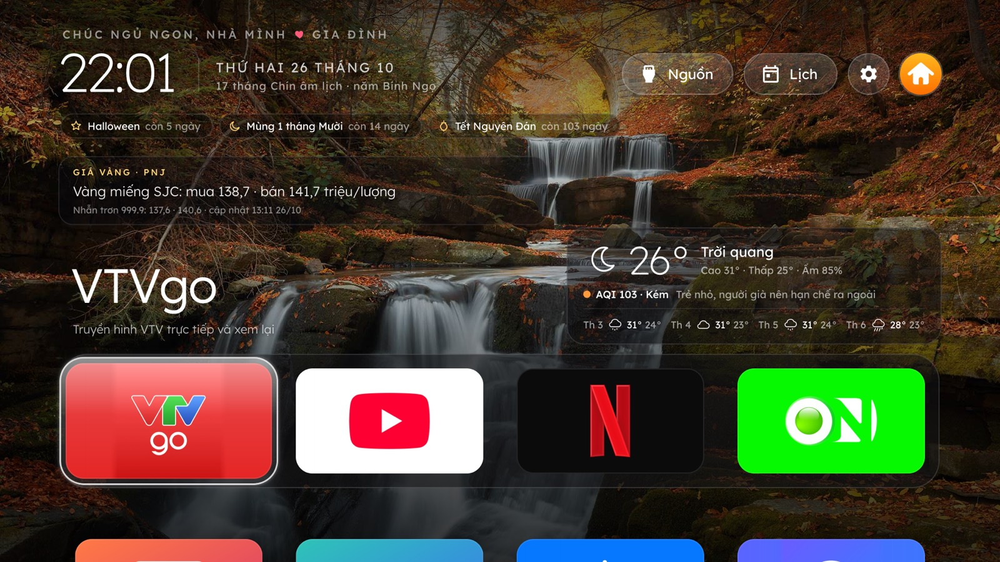
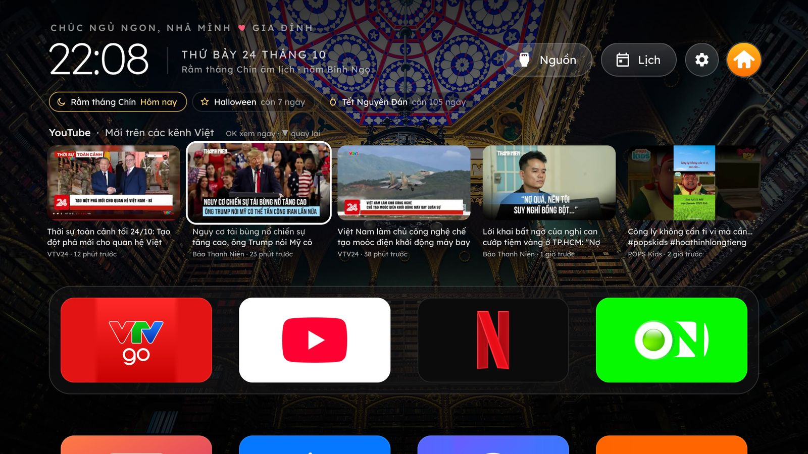
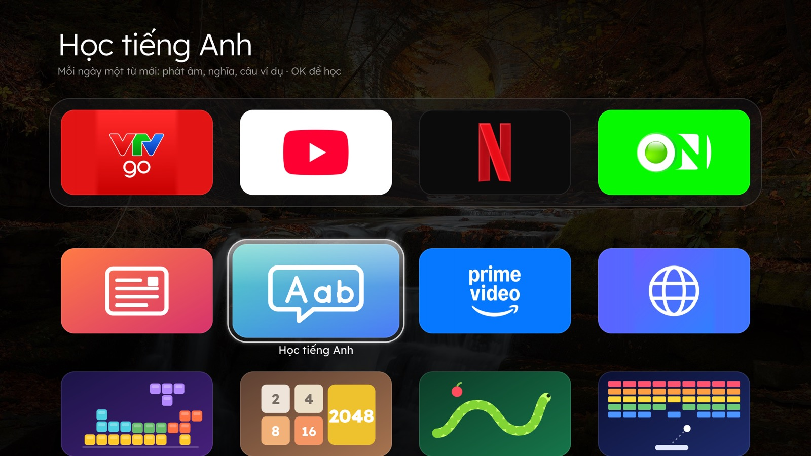
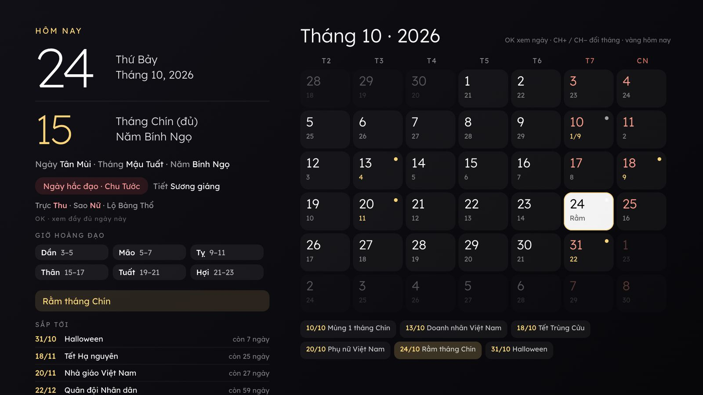
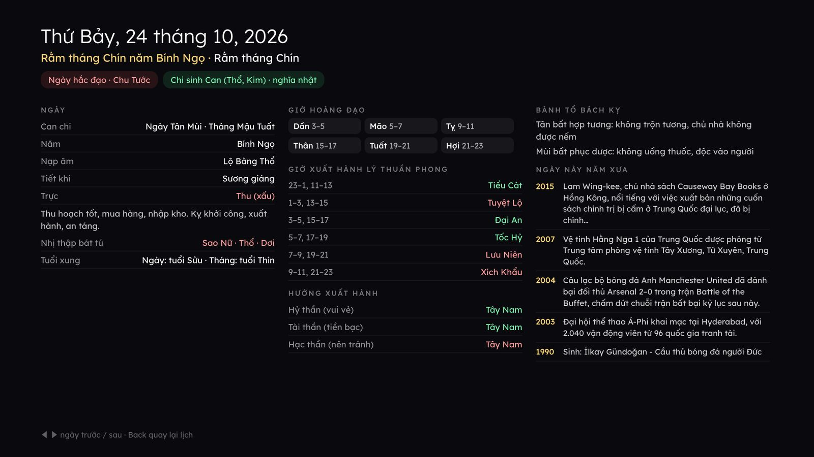
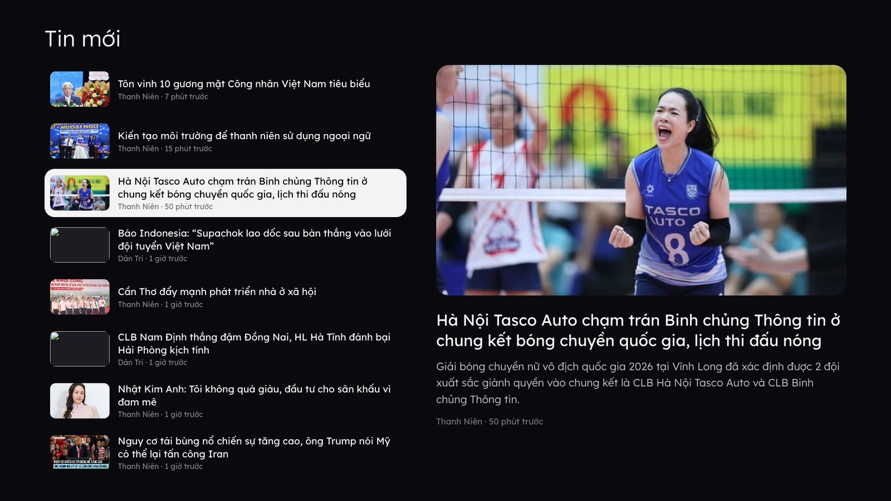
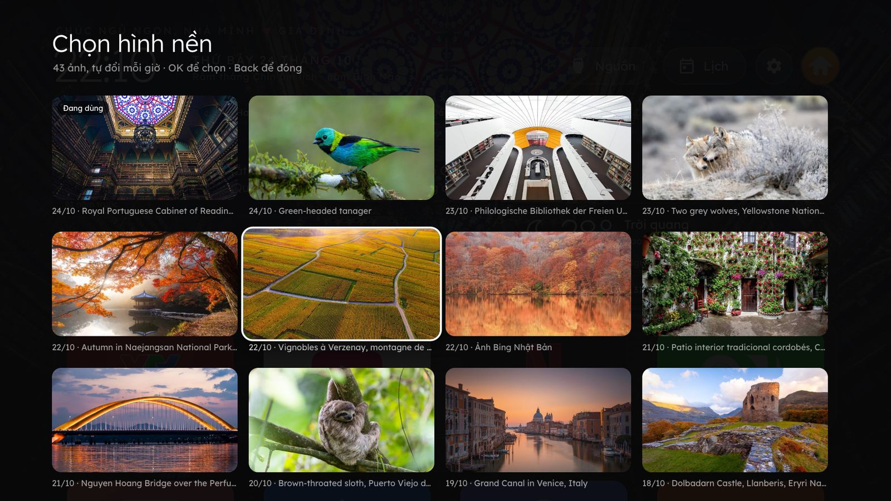
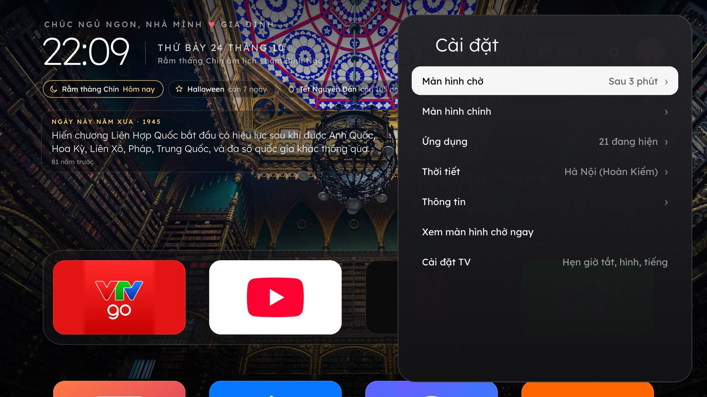
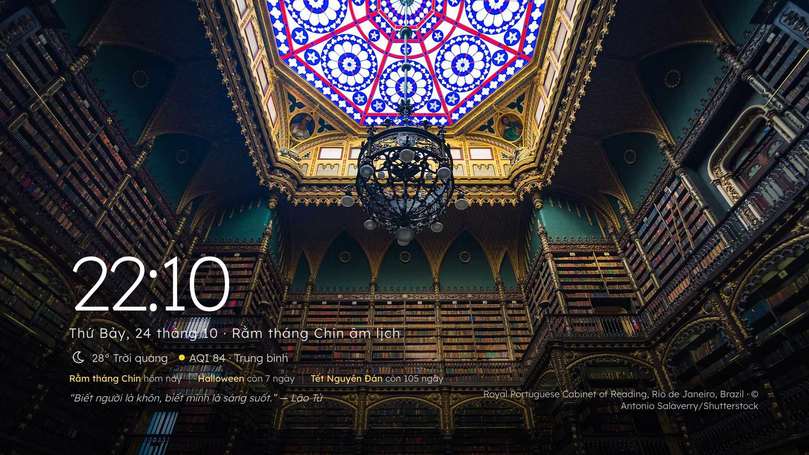

# Nhà Mình: màn hình chính kiểu Apple TV cho TV Samsung (Tizen)

Một app web thay chỗ màn hình Home cho TV Samsung đời 2020 trở đi (thử trên UA50TU8500, Tizen 5.5). Giao diện kiểu
Apple TV, có hình nền đẹp đổi theo giờ, thời tiết, lịch vạn niên, tin tức, hàng video YouTube, game chơi bằng remote.
Thoát app nào cũng quay về đây. Cài bằng Developer Mode, không cần root.

*An Apple TV–style home screen for Samsung Tizen TVs (2020+), written as a plain web app: rotating photo wallpapers,
weather and air quality, a Vietnamese lunar almanac, news, a YouTube row, remote-friendly games, and a background
service that brings you back home when you leave an app. UI text is Vietnamese.*



| | |
|---|---|
|  **Hàng YouTube**: video mới của các kênh chọn sẵn, OK là phát |  **Ứng dụng và game** |
|  **Lịch vạn niên** âm dương |  **Xem ngày**: trực, sao, giờ hoàng đạo, hướng xuất hành… |
|  **Tin mới** từ VnExpress, Thanh Niên, Dân Trí |  **Thư viện hình nền** |
|  **Cài đặt** nhiều tầng |  **Màn hình chờ** |

*Ảnh chụp từ bản xem thử với cấu hình mẫu. Ảnh nền là ảnh Bing trong ngày.*

## Tính năng

- **Dock 4 app** (mặc định VTV GO, YouTube, Netflix, VieON; phím 1–4 mở thẳng), lưới các app còn lại và 4 game. Giữ OK
  trên một ô để sắp xếp lại.
- **Hàng YouTube xổ ra**: dừng ở ô YouTube thì video mới của các kênh trong `youtubeChannels` hiện trên dock. ▲ để chọn,
  OK để phát thẳng video (cả khi YouTube đang mở), ▼ để gập lại. Dùng RSS công khai, không cần API key.
- **Khối Hôm nay** xoay vòng *Ngày này năm xưa* (Wikipedia), *Tin mới* và *Câu nói hay*: mỗi lượt một câu khác, gồm
  50 danh ngôn mới mỗi ngày (ZenQuotes, dịch sang tiếng Việt), ~130 câu chọn sẵn và tục ngữ (Wikiquote).
- **Thời tiết và AQI** (Open-Meteo): nhiệt độ, dự báo 4 ngày, chất lượng không khí kèm lời khuyên, "có thể mưa sau
  ~N phút".
- **Sắp tới**: Rằm, Mùng 1, ngày lễ dương và âm lịch, sinh nhật người nhà, đếm ngược Tết.
- **Lịch vạn niên**: lưới tháng âm dương. OK trên một ngày mở *Xem ngày*: can chi, Trực, 28 sao, nạp âm, giờ hoàng đạo,
  giờ Lý Thuần Phong, hướng xuất hành, tuổi xung, Bành Tổ, ngày Tam nương/Nguyệt kỵ/Dương công, ngày này năm xưa.
  Đã đối chiếu với lichvannien.net.
- **Hình nền**: ảnh Bing của 13 nước, kho tự lớn dần tới 120 ảnh, đổi mỗi giờ (chỉnh được), nhớ mốc lần đổi qua các lần
  tắt TV. *Thư viện hình nền* để chọn một ảnh dùng tạm hoặc giữ cố định. Có thêm chế độ ảnh gia đình, kết hợp, bầu trời
  theo giờ, nền đen.
- **Màn hình chờ** sau 3 phút không bấm gì: ảnh chuyển mờ dần xen ảnh gia đình, đồng hồ, âm lịch, thời tiết, câu nói.
- **Thoát app là về đây**: dịch vụ nền canh app đang mở (kể cả mở từ Smart Hub) và đưa về màn hình chính, thường dưới
  1 giây.
- **Nguồn vào** (HDMI, truyền hình, đặt tên riêng cho cổng), **Cài đặt** nhiều tầng như Apple TV, lối tắt vào cài đặt
  của TV.
- **Nhanh và nhẹ trên TV**: mọi thứ lưu sẵn trên TV, mở app không tải mạng, chỉ cập nhật khi tới hạn (xem
  [Kho dữ liệu](#kho-dữ-liệu-trên-tv)). Chạy trên Chromium 69 của Tizen 5.5, ES2018.

## Cài đặt

Cần: một máy Mac (Intel hoặc Apple Silicon) cùng mạng với TV, và TV Samsung Tizen (2017 trở đi; thử kỹ trên 2020).
**Hướng dẫn từng bước, kèm cách xử lý lỗi: [docs/huong-dan-cai-dat.md](docs/huong-dan-cai-dat.md).** Tóm tắt:

1. **Bật Developer Mode trên TV**: mở *Ứng dụng*, bấm `1 2 3 4 5` trên remote (remote không có phím số thì bấm nút
   **123** để hiện bàn phím số), bật *Developer mode*, nhập **IP máy Mac** vào *Host PC IP*, rồi giữ nút nguồn 5 giây
   để TV khởi động lại hẳn.
2. **Chuẩn bị máy Mac** (một lần): cài Tizen Studio CLI và tạo chứng chỉ ký app.

   ```bash
   git clone https://github.com/meocong/prj-tv-samsung.git && cd prj-tv-samsung
   tools/setup-mac.sh
   ```
3. **Cá nhân hóa** (tùy chọn): tên nhà, vị trí thời tiết, ảnh gia đình. Xem [phần dưới](#cá-nhân-hóa).
4. **Cài lên TV**:

   ```bash
   TV_HOST=<IP TV> tools/deploy.sh      # kiểm tra, đóng gói, ký, cài, mở app
   ```
5. **Cài đặt TV** cho màn hình chính lên ngay khi bật TV và tắt quảng cáo, theo dõi: làm theo
   [docs/cai-dat-tv.md](docs/cai-dat-tv.md) (Autorun Last App, DNS chặn quảng cáo, Developer Mode…).

## Cá nhân hóa

Repo chỉ chứa cấu hình mẫu. Thông tin riêng của nhà bạn để trong thư mục `local/`, không bao giờ lên Git (đã có trong
`.gitignore`). Khi deploy hay xem thử, `local/` được ghép đè lên `app/`.

```bash
cp -R local.example local                 # rồi sửa local/config.local.js
tools/.venv/bin/python tools/photos.py ~/Pictures/a.jpg ~/Pictures/b.jpg   # ảnh gia đình → local/img/family/
cp ~/Pictures/avatar.jpg local/img/avatar.jpg                              # ảnh tròn góc phải
```

| File trong `local/` | Dùng để |
|---|---|
| `config.local.js` | Ghi đè [app/config.js](app/config.js): `familyName`, `location`/`locations`, `familyPhotos`, `birthdays`… |
| `app-name.txt` | Tên app trên Smart Hub (dòng đầu). Đổi tên thì phải gỡ app rồi cài lại TV mới nhận. |
| `img/avatar.jpg` | Ảnh avatar góc phải. |
| `img/family/*.jpg` | Ảnh gia đình 1920×1080 (tạo bằng `tools/photos.py`: ảnh dọc được đặt khung trên nền mờ). |

Các tùy chọn chung (dock, app ẩn, kênh YouTube, tên cổng HDMI, mặc định của Cài đặt) nằm trong
[app/config.js](app/config.js). Sau khi đổi app trên TV (cài thêm, gỡ bớt), chạy
`tools/.venv/bin/python tools/sync_apps.py` để cập nhật danh sách app và icon.

## Phát triển

```bash
python3 tools/preview.py                  # xem thử trên Chrome: http://localhost:8765 (ghép local/)
python3 tools/preview.py 8765 --public    # đúng như người khác thấy khi clone repo
node --test tests/*.test.js               # âm lịch, lịch vạn niên, ngày lễ, câu nói, ngày này năm xưa, kho ảnh
tools/check_compat.sh                     # chặn cú pháp mới hơn ES2018 (Chromium 69 của TV)
```

- **Debug trên TV**: `sdb shell 0 was_kill NhaMinh000.NhaMinh`, rồi `sdb shell 0 debug NhaMinh000.NhaMinh` in ra cổng;
  `sdb forward tcp:9333 tcp:<cổng>`; rồi `node tools/inspect.js --port 9333 --eval "NhaMinhDebug.wall()"` (chạy JS,
  gửi phím, chụp màn hình). `performance` có mốc `scripts`, `home`, `ready` để đo thời gian mở app.
- **Dịch vụ nền**: `http://<IP TV>:8701/` cho biết dịch vụ chạy từ lúc nào, đang canh app nào và nhật ký gần đây.
- **Trạng thái app**: `curl http://<IP TV>:8001/api/v2/applications/<id>` (YouTube cần mã store `111299001912`).
- **Điều khiển TV từ máy**: `tools/.venv/bin/python tools/tv.py key KEY_HOME`.

## Cách hoạt động

- **Thoát app là về đây.** Samsung không cho app tự cài làm nút Home. Một dịch vụ nền
  ([app/service/watch.js](app/service/watch.js)) hỏi REST API của chính TV (`127.0.0.1:8001`) mỗi 0,3 giây xem app đang
  canh còn chạy, còn hiện không. App đó tắt hoặc khuất quá 1,2 giây thì mở lại màn hình chính. Khi không có app nào được
  mở từ đây, dịch vụ vẫn dò vài giây một lần xem có app nào đang hiện để canh luôn. Lúc TV sắp tắt (PowerState rời "on"),
  nó đưa màn hình chính lên trước, để TV chỉ ngủ (Instant On) thì bật lên là thấy màn hình chính.
- **Mở thẳng video YouTube**: app-control `PAYLOAD` dạng `v=<mã video>&t=0`, giống điện thoại cast lên TV.
- **Mượt trên TV yếu**: hình nền vẽ sẵn vào canvas, chỉ 1–2 lớp toàn màn hình, các khối mờ dần có lớp riêng, ảnh giải mã
  trước khi chuyển, việc phụ dời sang lúc rảnh.

### Kho dữ liệu trên TV

Mở app là hiện ngay từ kho. Chỉ tải mạng khi đã tới hạn, không tải chỉ vì vừa mở app. Kho nào cũng có giới hạn.

| Kho | Giữ | Làm mới |
|---|---|---|
| Ảnh nền (IndexedDB) | 30 ảnh ≈ 12 MB, xóa ảnh lâu không dùng nhất | ảnh kế tiếp tải sẵn |
| Danh sách ảnh Bing | 120 ảnh gần nhất | mỗi ngày một lần |
| Câu nói hay | 600 danh ngôn (cộng dồn 50 câu mỗi ngày) + tục ngữ | mỗi ngày; tục ngữ mỗi tuần |
| Hàng YouTube | 12 video mới nhất | mỗi giờ |
| Tin mới | 40 tin | 20 phút |
| Ngày này năm xưa (IndexedDB) | mãi mãi, tối đa 366 trang ngày ≈ 1,5 MB | mỗi ngày chỉ tải một lần; tải sẵn 7 ngày tới |
| Thời tiết | mỗi nơi đã chọn một bản | khi bản đang có cũ hơn 20 phút |

## Hạn chế đã biết

- Nút **Home** trên remote vẫn mở thanh Home của Samsung; không app nào thay được nút này.
- Samsung không cho app cài bằng chứng chỉ thường tự chạy khi TV khởi động: không on-boot, không prelaunch (bỏ từ 2019),
  và "Tự động chạy ứng dụng cuối cùng" chỉ dành cho app Samsung cho phép. Để bật TV là vào thẳng màn hình chính, dùng một
  quy tắc SmartThings "TV bật → mở app" ([docs/cai-dat-tv.md](docs/cai-dat-tv.md#2-bật-tv-là-vào-thẳng-màn-hình-chính)).
- Gợi ý, "xem tiếp" của YouTube, Netflix nằm trong từng app; Samsung không cho app khác đọc.

Chi tiết và cách gỡ bỏ: [docs/cai-dat-tv.md](docs/cai-dat-tv.md).

## Cấu trúc

```
app/            app web Tizen: config.xml, index.html, css/, js/, service/ (dịch vụ nền), games/, icons/, fonts/, img/
local.example/  mẫu cấu hình riêng (chép thành local/, không lên Git)
tools/          setup-mac.sh, deploy.sh, preview.py, photos.py, sync_apps.py, tv.py, inspect.js, check_compat.sh
docs/           huong-dan-cai-dat.md (cài từ đầu, xử lý lỗi), cai-dat-tv.md (cài đặt TV, DNS, hạn chế, gỡ bỏ), screenshots/
tests/          test Node: âm lịch, lịch vạn niên, ngày lễ, nội dung
```

## Giấy phép

[MIT](LICENSE) © 2026 Nguyễn Trọng Hoàng Việt. Mã của bên thứ ba giữ giấy phép riêng (xem [NOTICE](NOTICE)).

## Ghi công

Lấy cảm hứng từ [cleanyourtv](https://github.com/Gathin23/cleanyourtv) (Android TV). Giao diện port từ
[webos-vibehack](https://github.com/OmkarK97/webos-vibehack). Game, font và mã của bên thứ ba cùng giấy phép của chúng:
xem [NOTICE](NOTICE).

Dữ liệu: Bing Image of the Day, [Open-Meteo](https://open-meteo.com) (CC BY 4.0), Wikipedia và Wikiquote tiếng Việt
(CC BY-SA), [ZenQuotes](https://zenquotes.io), RSS của VnExpress, Thanh Niên, Dân Trí và các kênh YouTube. Thuật toán
âm lịch theo Hồ Ngọc Đức. Logo app trong `app/icons/` thuộc về chủ sở hữu của từng app.
